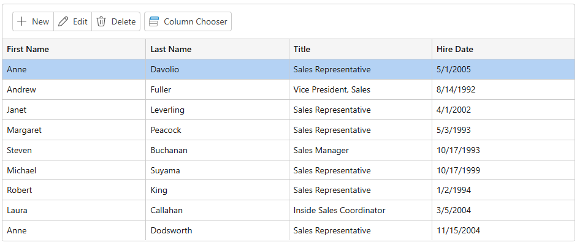

<!-- default badges list -->

[](https://supportcenter.devexpress.com/ticket/details/T802157)
[](https://docs.devexpress.com/GeneralInformation/403183)
[](#does-this-example-address-your-development-requirementsobjectives)
<!-- default badges end -->

# Blazor Grid — Add CRUD Commands to the DevExpress Data Grid's Integrated Toolbar

This example integrates a [Toolbar](https://docs.devexpress.com/Blazor/DevExpress.Blazor.DxToolbar) into a [DevExpress Blazor Grid](https://docs.devexpress.com/Blazor/DevExpress.Blazor.DxGrid) component and populates the toolbar with CRUD commands.



## Implementation Details

Add a [ToolbarTemplate](https://docs.devexpress.com/Blazor/DevExpress.Blazor.DxGrid.ToolbarTemplate) to the Grid markup to attach a toolbar to your Grid component. This template adds all necessary styles automatically. 

Add a [DxToolbar](https://docs.devexpress.com/Blazor/DevExpress.Blazor.DxToolbar) component to the template and populate it with items. You can use [predefined commands](https://docs.devexpress.com/Blazor/DevExpress.Blazor.DxGrid.ToolbarTemplate?v=26.2#built-in-items) (**Edit**, **Delete**, and **Column Chooser**) or [create custom commands](https://docs.devexpress.com/Blazor/DevExpress.Blazor.DxGrid.ToolbarTemplate?v=26.2#custom-items) (**Add**).

Built-in CRUD commands rely on the [focused row](https://docs.devexpress.com/Blazor/404461/components/grid/selection-and-focus#focused-row), so activate the associated Data Grid option.

```Razor
<DxGrid Data="Data"
        FocusedRowEnabled="true">
    <Columns>
        @* ... *@
    </Columns>
    <ToolbarTemplate>
        <DxToolbar>
            <DxToolbarItem Text="New"
                           IconUrl="@Icons.Add.PaletteNeutral"
                           Click="OnCreateNew" />
            <DxGridEditRowToolbarItem />
            <DxGridDeleteRowToolbarItem />
            <DxGridColumnChooserToolbarItem BeginGroup="true"/>
        </DxToolbar>
    </ToolbarTemplate>
</DxGrid>
```

Handle the following CRUD-related events to process user input and post changes to the underlying data source: [EditModelSaving](https://docs.devexpress.com/Blazor/DevExpress.Blazor.DxGrid.EditModelSaving), [DataItemDeleting](https://docs.devexpress.com/Blazor/DevExpress.Blazor.DxGrid.DataItemDeleting), and [CustomizeEditModel](https://docs.devexpress.com/Blazor/DevExpress.Blazor.DxGrid.CustomizeEditModel):

```Razor
<DxGrid Data="Data"
        CustomizeEditModel="OnCustomizeEditModel"
        EditModelSaving="OnEditModelSaving"
        DataItemDeleting="OnDataItemDeleting"
        KeyFieldName="EmployeeId"
        EditMode="GridEditMode.EditForm"
        FocusedRowEnabled="true"
        @ref="MyGrid">
    @* ... *@
</DxGrid>

@code {
    IGrid MyGrid { get; set; }
    IEnumerable<object> Data { get; set; }

    void OnCustomizeEditModel(GridCustomizeEditModelEventArgs e) {
        if (e.IsNew) {
            var editModel = (Employee)e.EditModel;
            editModel.EmployeeId = Northwind.Employees.Max(x => x.EmployeeId) + 1;
        }
    }

    async Task OnEditModelSaving(GridEditModelSavingEventArgs e) {
        var editModel = (Employee)e.EditModel;
        // Assign changes from the edit model to the data item.
        if (e.IsNew)
            await Northwind.AddAsync(editModel);
        else
            e.CopyChangesToDataItem();
        // Post changes to the database.
        await Northwind.SaveChangesAsync();
        // Reload the entire Grid.
        Data = await Northwind.Employees.ToListAsync();
    }

    async Task OnDataItemDeleting(GridDataItemDeletingEventArgs e) {
        // Re-query a data item from the database.
        var dataItem = Northwind.Employees.Find((e.DataItem as Employee).EmployeeId);
        if (dataItem != null) {
            // Remove the data item from the database.
            Northwind.Remove(dataItem);
            await Northwind.SaveChangesAsync();
            // Reload the entire Grid.
            Data = await Northwind.Employees.ToListAsync();
        }
    }
}
```

## Files to Review

- [Index.razor](./CS/SampleBlazorApp/Pages/Index.razor)

## Documentation

- [DxGrid.ToolbarTemplate](https://docs.devexpress.com/Blazor/DevExpress.Blazor.DxGrid.ToolbarTemplate)
- [ToolbarItem](https://docs.devexpress.com/Blazor/DevExpress.Blazor.DxToolbarItem)

## More Examples

- [Blazor Grid - Display a Context Menu](https://github.com/DevExpress-Examples/blazor-dxgrid-show-context-menu)

<!-- feedback -->
## Does This Example Address Your Development Requirements/Objectives?

[](https://www.devexpress.com/support/examples/survey.xml?utm_source=github&utm_campaign=blazor-grid-and-toolbar&~~~was_helpful=yes) [](https://www.devexpress.com/support/examples/survey.xml?utm_source=github&utm_campaign=blazor-grid-and-toolbar&~~~was_helpful=no)

(you will be redirected to DevExpress.com to submit your response)
<!-- feedback end -->
